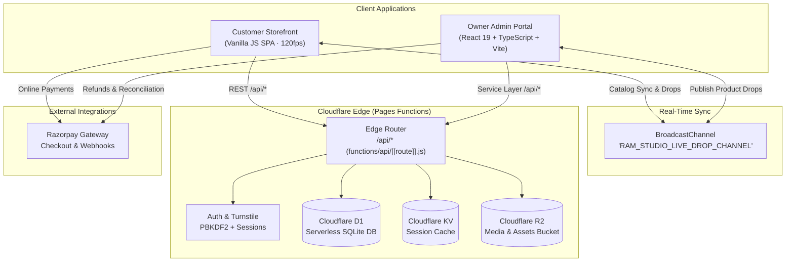
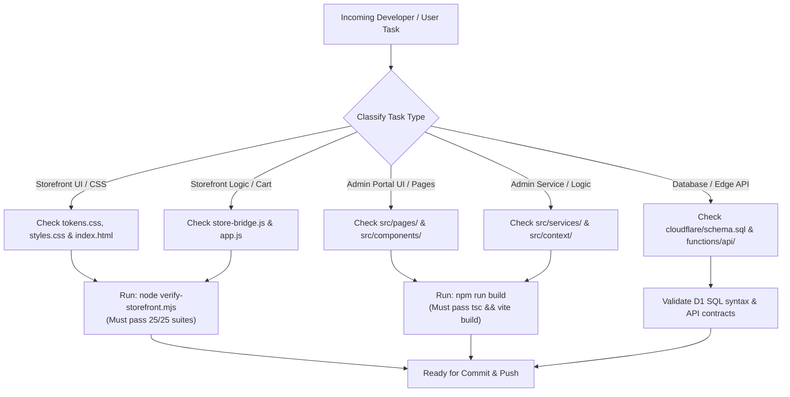

# AGENTS.md — AI Agent Operating Manual & Repository Directives

> **Project Ecosystem:** Vistāra Krafts & POTRY Ceramics E-Commerce Platform  
> **Customer Storefront:** `https://vistara-krafts.vercel.app` (Repo: `https://github.com/abhieee-java/vistara-krafts`)  
> **Owner Admin Portal:** `https://vistara-krafts-admin.vercel.app` (Repo: `https://github.com/abhieee-java/vistara-krafts-admin`)  
> **Production Domain Target:** `https://vistarakrafts.in`  
> **Author & Architect:** Antigravity Super-Designer & Principal Systems Architect  
> **Last Updated:** October 2026  

---

## 1. Prime Directives for All AI Agents

When reading, modifying, auditing, or extending either codebase in this ecosystem, every AI agent (Antigravity, Claude, Codex, Gemini, Cursor) and human engineer must strictly uphold these eight core invariants:

### 1. Strict Decoupling: Storefront vs. Admin Portal
- **The Storefront (`stitch_potry_e_commerce_storefront`) is strictly customer-facing.**
  - There must **never** be an admin panel, owner dashboard, vendor login, inventory modifier, or CMS editor embedded in the storefront codebase.
  - The storefront is an ultra-fast, zero-framework vanilla JS SPA designed for maximum conversion and Awwwards-level craft.
- **The Admin Portal (`vistara_krafts_admin_portal`) is an isolated administrative suite.**
  - Built with React 19, TypeScript, Vite, and Tailwind CSS v4.
  - Communicates with the backend via a clean, modular service layer (`authService`, `productService`, `inventoryService`, `orderService`, `customerService`, `storageService`, `systemService`).
  - Broadcasts catalog changes in real time via the browser `BroadcastChannel('RAM_STUDIO_LIVE_DROP_CHANNEL')` to sync live customer tabs.

### 2. Backend Authority: Cloudflare Ecosystem Exclusively
- The backend architecture is built strictly on **Cloudflare**:
  - **Cloudflare Pages & Pages Functions (`functions/api/[[route]].js`)**: Edge serverless compute.
  - **Cloudflare D1 (`cloudflare/schema.sql`)**: Edge serverless SQLite SQL database.
  - **Cloudflare R2**: High-performance S3-compatible media and asset storage.
  - **Cloudflare KV**: Ephemeral high-speed session tokens and cache.
  - **Cloudflare Turnstile**: Zero-friction privacy-preserving bot detection.
- **Do NOT introduce Supabase, Firebase, AWS, or external database ORMs.** All data models must align with Cloudflare D1 SQL.

### 3. Payment Gateway: Razorpay Exclusively
- All transactions use **Razorpay** in Indian Rupees (`INR` / `₹`).
- Client-side checkout loads `checkout.razorpay.com/v1/checkout.js`.
- Payments are verified server-side using SHA-256 HMAC of `razorpay_order_id + "|" + razorpay_payment_id` against the secret key.

### 4. Two-Part Authentication & Curation Flow (Storefront Invariant)
- **Part 1 (Credentials Only):** The customer signs in or registers via Email/Password, 1-Click Google OAuth, or Apple ID. **No persona questions are allowed in Part 1.**
- **Part 2 (Curation Step):** Only after authentication is complete, the customer is presented with: *"Curate Your Studio Feed"*.
- **Persona Options:** Strictly `👔 Male` and `🌸 Female`.
- **Zero "Universal" Button Rule:** The word or button "Universal" must **never** appear as an option. If the user dismisses the dialog (via `✕` Close or *"Skip for Now & Continue"*), the system silently defaults to the universal feed (`persona = 'all'`) without ever exposing a "Universal" button.

### 5. Supplementary Product Varieties & Gender Targeting
- **Varieties (Colors, Shapes, Sizes) are Supplementary / Optional:**
  - In the Admin Portal product modal, variety inputs are completely optional and left blank by default.
  - **Blank = Intact Product:** If left blank, the product has no varieties. The storefront completely omits variety drawers, buttons, and badges.
  - If specified (comma-separated), values are parsed and rendered dynamically on the storefront.
- **Gender Targeting:**
  - In Admin Portal: Options are `Universal (Men & Women)` (Default), `Mainly for Female / Women`, or `Mainly for Male / Men`.
  - Stored as `gender: 'all' | 'women' | 'men'`.
  - In Storefront: Rendered as subtle affinity badges (`🌸 Mainly for Female / Women`, `👔 Mainly for Male / Men`) and powers feed curation.

### 6. Visual Brand Palette & Typography (60/30/10 Rule)
- **60% Canvas & Cards:** Warm Alabaster (`#faf8f5`), Pure Gallery White (`#ffffff`), Warm Mist (`#f3f1ec`).
- **30% Structure & Authority:** Deep Naval Sapphire (`#031a38`), Hairline Stone Borders (`#e4e0d8`), Slate Ink (`#1e293b`).
- **10% Artisan Accents:** Antique Brass (`#b08d57`), Warm Gold Flecks (`#ffd79b`), Crimson Vermilion (`#9e3322`).
- Never use cold pitch-black obsidian backgrounds or generic Bootstrap grey layouts.

### 7. Non-Negotiable Verification Standards
- **Storefront Verification:** Run `node verify-storefront.mjs` — all 25 test suites must pass (`25 passed, 0 failed`).
- **Admin Portal Verification:** Run `npm run build` (`tsc && vite build`) — must compile with zero TypeScript or Vite errors.
- **Touch Accessibility:** Every interactive control (button, input, select, tab) must maintain `min-height: 44px` (WCAG 2.2 AA).
- **Responsive Geometry:** Zero horizontal scroll/overflow across viewports from 320px to 1920px.

### 8. Zero Stubs & Zero Placeholder Policy
- Never leave mock placeholders, broken buttons, unfinished screens, or hardcoded dummy credentials in production pathways.
- All forms, filters, drawers, and modal transitions must have complete state lifecycles (idle, loading, success, error, empty).

---

## 2. System Architecture & Agent Navigation Map

---

## 3. Directory Layout & File Responsibilities

### Repository A: Storefront (`stitch_potry_e_commerce_storefront`)
| File / Directory | Purpose & Invariant |
| :--- | :--- |
| `index.html` | Core SPA entry point with responsive meta, SEO JSON-LD graph, and modal shells. |
| `app.js` | Main SPA router, DOM rendering, UI controllers, product cards, and liquid resin physics. |
| `store-bridge.js` | Reactive state management, cart engine, volume tier pricing, auth state, and BroadcastChannel listener. |
| `styles.css` / `tokens.css` | 60/30/10 warm gallery tokens, typography clamp rules, keyframe animations, and 44px touch targets. |
| `functions/api/[[route]].js` | Cloudflare Pages Function edge API handling auth, orders, health, SEO, and session verification. |
| `cloudflare/schema.sql` | Canonical D1 SQLite database DDL (`users`, `sessions`, `orders`). |
| `verify-storefront.mjs` | Automated 25-suite verification runner testing schema, routes, pricing, and responsive layouts. |

### Repository B: Admin Portal (`vistara_krafts_admin_portal`)
| File / Directory | Purpose & Invariant |
| :--- | :--- |
| `src/App.tsx` | Main application router, authenticated route guards, layout scaffolding. |
| `src/context/` | React context providers for `AuthContext`, `RouterContext`, `StoreContext`. |
| `src/services/` | Decoupled service layer (`authService`, `productService`, `inventoryService`, `orderService`, `customerService`, `storageService`, `systemService`). |
| `src/pages/` | Production admin screens: `Dashboard`, `Products`, `Inventory`, `Orders`, `Customers`, `Analytics`, `Promotions`, `Security`, `Settings`, `SystemHealth`, `Login`. |
| `src/components/products/` | `ProductFormModal.tsx` (Gender selector & supplementary varieties), `ImageUploader.tsx` (Cloudflare R2 image manager). |
| `src/components/orders/` | `OrderDetailDrawer.tsx` (Status workflow & timeline), `InvoiceModal.tsx` (GST-compliant invoice printer). |

---

## 4. Agent Execution Flowchart

---

## 5. Security & Secret Management Directives
- **Zero Secrets in Client Code:** Never expose `CLOUDFLARE_API_TOKEN`, `TURNSTILE_SECRET_KEY`, or `RAZORPAY_KEY_SECRET` in frontend files.
- **Environment Variables:**
  - Client-safe keys: `VITE_RAZORPAY_KEY_ID`, `VITE_USE_MOCK_SERVICES`, `TURNSTILE_SITE_KEY`.
  - Server-side only: `RAZORPAY_KEY_SECRET`, `TURNSTILE_SECRET_KEY`, `D1_DATABASE_ID`.
- **PBKDF2 Password Hashing:** Client passwords must be hashed server-side using PBKDF2 with 50,000 SHA-256 iterations and a unique cryptographic salt.
- **Session Tokens:** Generated via `crypto.randomUUID()`, hashed with SHA-256, and stored in HTTP-Only, SameSite=Lax cookies or Bearer headers.
