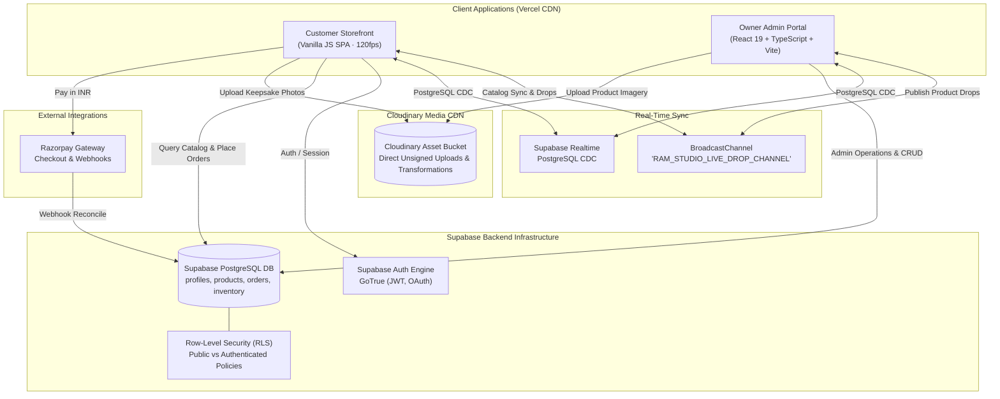
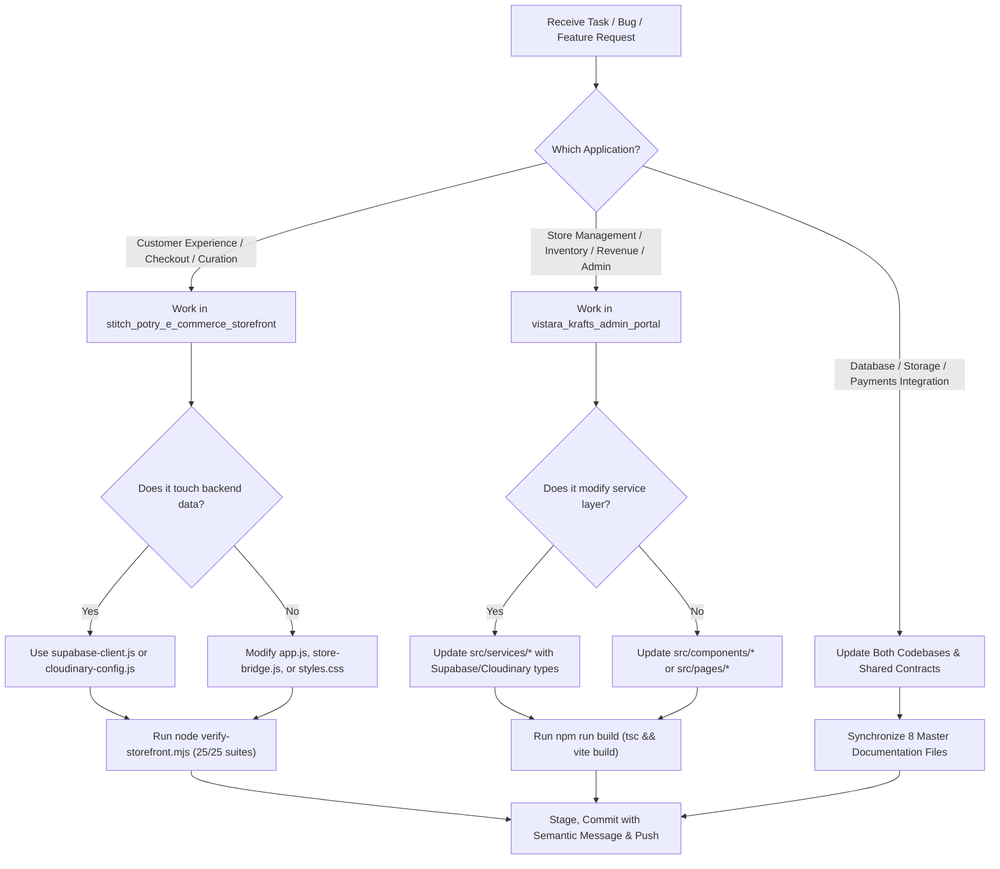

# AGENTS.md — AI Agent Operating Manual & Repository Directives

> **Project Ecosystem:** Vistāra Krafts & POTRY Ceramics E-Commerce Platform  
> **Customer Storefront:** `https://vistara-krafts.vercel.app` (Repo: `https://github.com/abhieee-java/vistara-krafts`)  
> **Owner Admin Portal:** `https://vistara-krafts-admin.vercel.app` (Repo: `https://github.com/abhieee-java/vistara-krafts-admin`)  
> **Production Domain Target:** `https://vistarakrafts.com` (Storefront; Admin portal domain to be assigned by owner)  
> **Backend & Database:** Supabase PostgreSQL 15+ (`supabase/schema.sql`) with Supabase Auth  
> **Media CDN & Storage:** Cloudinary (`cloudinary-config.js` / `storageService.ts`)  
> **Payments:** Razorpay (INR transactions with webhook signature verification)  
> **Author & Architect:** Antigravity Super-Designer & Principal Systems Architect  
> **Last Updated:** October 2026  

---

## 1. Prime Directives for All AI Agents

When reading, modifying, auditing, or extending either codebase in this ecosystem, every AI agent (Antigravity, Claude, Codex, Gemini, Cursor) and human engineer must strictly uphold these eight core invariants:

### 1. Strict Decoupling: Storefront vs. Admin Portal
- **The Storefront (`stitch_potry_e_commerce_storefront`) is strictly customer-facing.**
  - There must **never** be an admin panel, owner dashboard, vendor login, inventory modifier, or CMS editor embedded in the storefront codebase.
  - The storefront is an ultra-fast, zero-framework vanilla JS SPA designed for maximum conversion, zero layout shift, and Awwwards-level craft.
- **The Admin Portal (`vistara_krafts_admin_portal`) is an isolated administrative suite.**
  - Built with React 19, TypeScript, Vite, and Tailwind CSS v4.
  - Communicates with the backend via a clean, modular service layer (`authService`, `productService`, `inventoryService`, `orderService`, `customerService`, `storageService`, `systemService`).
  - Broadcasts catalog changes in real time via the browser `BroadcastChannel('RAM_STUDIO_LIVE_DROP_CHANNEL')` to sync live customer tabs.

### 2. Backend Authority: Supabase (Database & Auth) & Cloudinary (Storage)
- The backend architecture is built strictly on **Supabase** and **Cloudinary**:
  - **Supabase Database (`supabase/schema.sql`)**: PostgreSQL 15+ with Row-Level Security (RLS), triggers, and Realtime CDC.
  - **Supabase Auth**: GoTrue engine supporting Email/Password, 1-Click Google OAuth, and secure JWT session handling.
  - **Cloudinary Storage**: High-performance image and media storage with direct unsigned uploads and on-the-fly transformations (`f_auto,q_auto`).
  - **Zero Cloudflare Dependencies**: Cloudflare D1, Cloudflare R2, Cloudflare KV, and Cloudflare Pages Functions have been completely replaced. Do NOT reintroduce Cloudflare backend services.

### 3. Payment Gateway: Razorpay Exclusively
- All transactions use **Razorpay** in Indian Rupees (`INR` / `₹`).
- Client-side checkout loads `checkout.razorpay.com/v1/checkout.js`.
- Payments are verified server-side using SHA-256 HMAC of `razorpay_order_id + "|" + razorpay_payment_id` against the secret key.

### 4. Two-Part Authentication & Curation Flow (Storefront Invariant)
- **Part 1 (Credentials Only):** The customer signs in or registers via Email/Password, 1-Click Google OAuth, or Apple ID. **No persona questions are allowed in Part 1.**
- **Part 2 (Curation Step):** Only after authentication is complete, the customer is presented with: *"Curate Your Studio Feed"*.
- **Persona Options:** Strictly `👔 Male` and `🌸 Female`.
- **Zero "Universal" Button Rule:** The word or button "Universal" must **never** appear as an option. If the user dismisses the dialog (via `✕` Close or *"Skip for Now & Continue"*), the system silently defaults to the universal feed (`persona = 'all'`) without ever exposing a "Universal" button.

### 5. Supplementary Product Varieties & Gender Targeting
- **Varieties (Colors, Shapes, Sizes) are Supplementary / Optional:**
  - In the Admin Portal product modal, variety inputs are completely optional and left blank by default.
  - **Blank = Intact Product:** If left blank, the product has no varieties. The storefront completely omits variety drawers, buttons, and badges.
  - If specified (comma-separated), values are parsed and rendered dynamically on the storefront.
- **Gender Targeting:**
  - In Admin Portal: Options are `Universal (Men & Women)` (Default), `Mainly for Female / Women`, or `Mainly for Male / Men`.
  - Stored as `gender: 'all' | 'women' | 'men'`.
  - In Storefront: Rendered as subtle affinity badges (`🌸 Mainly for Female / Women`, `👔 Mainly for Male / Men`) and powers feed curation.

### 6. Visual Brand Palette & Typography (60/30/10 Rule)
- **60% Canvas & Cards:** Warm Alabaster (`#faf8f5`), Pure Gallery White (`#ffffff`), Warm Mist (`#f3f1ec`).
- **30% Structure & Authority:** Deep Naval Sapphire (`#031a38`), Hairline Stone Borders (`#e4e0d8`), Slate Ink (`#1e293b`).
- **10% Artisan Accents:** Antique Brass (`#b08d57`), Warm Gold Flecks (`#ffd79b`), Crimson Vermilion (`#9e3322`).
- Never use cold pitch-black obsidian backgrounds or generic Bootstrap grey layouts.

### 7. Non-Negotiable Verification Standards
- **Storefront Verification:** Run `node verify-storefront.mjs` — all 25 test suites must pass (`25 passed, 0 failed`).
- **Admin Portal Verification:** Run `npm run build` (`tsc && vite build`) — must compile with zero TypeScript or Vite errors.
- **Touch Accessibility:** Every interactive control (button, input, select, tab) must maintain `min-height: 44px` (WCAG 2.2 AA).
- **Responsive Geometry:** Zero horizontal scroll/overflow across viewports from 320px to 1920px.

### 8. Zero Stubs & Zero Placeholder Policy
- Never leave mock placeholders, broken buttons, unfinished screens, or hardcoded dummy credentials in production pathways.
- All forms, filters, drawers, and modal transitions must have complete state lifecycles (idle, loading, success, error, empty).

---

## 2. System Architecture & Agent Navigation Map

---

## 3. Directory Structure & File Manifests

### Customer Storefront (`stitch_potry_e_commerce_storefront`)
| File | Role & Description |
| :--- | :--- |
| `index.html` | Semantic single-page application shell, structured JSON-LD microdata, WCAG dialogs |
| `app.js` | SPA routing, view rendering, pour calculator, modals, feed curation |
| `store-bridge.js` | Core reactive state engine, cart calculations, GST, offline resilience |
| `supabase-client.js` | Supabase API adapter (Auth, PostgREST queries, Realtime subscriptions) |
| `cloudinary-config.js` | Cloudinary unsigned media upload engine and auto-optimization helpers |
| `styles.css` / `tokens.css` | High-craft design tokens, GPU animations, glassmorphism, responsive grid |
| `supabase/schema.sql` | Production PostgreSQL 15+ schema with RLS and triggers |
| `verify-storefront.mjs` | Automated CI/CD test runner covering 25 comprehensive verification suites |

### Owner Admin Portal (`vistara_krafts_admin_portal`)
| File | Role & Description |
| :--- | :--- |
| `src/App.tsx` | Main application shell, route definitions, layout wrapper, live alerts |
| `src/pages/Dashboard.tsx` | Executive analytics, metric cards, revenue & order charts, quick stats |
| `src/pages/Products.tsx` | Complete catalog manager, filtering, sorting, bulk operations, drop publisher |
| `src/pages/Inventory.tsx` | Stock control, audit history, stock adjustments, low-stock alerts |
| `src/pages/Orders.tsx` | Order fulfillment board, status workflows, tracking updates, GST invoices |
| `src/pages/Customers.tsx` | Customer CRM, order histories, lifetime value metrics, segment filtering |
| `src/pages/SystemHealth.tsx` | Real-time status monitors for Supabase, Cloudinary, Razorpay, Webhooks |
| `src/services/*` | Modular service abstractions (auth, product, inventory, order, storage, system) |
| `supabase/schema.sql` | Mirrored PostgreSQL schema matching storefront production contracts |

---

## 4. Agent Decision-Making Tree

When assigned a task, follow this workflow to determine where and how to implement changes:

---

## 5. Security & Operational Rules for Agents

- **Zero Secrets in Git:** Never commit live API secret keys, service role keys, or database master passwords. Always use environment variables (`VITE_SUPABASE_ANON_KEY`, `VITE_CLOUDINARY_CLOUD_NAME`, `VITE_RAZORPAY_KEY_ID`).
- **Idempotent Migrations:** All SQL scripts in `supabase/schema.sql` must use `CREATE TABLE IF NOT EXISTS`, `DO $$ BEGIN ... END $$`, and safe index creation.
- **Fail-Safe Mock Fallback:** When live API credentials are not yet configured in `.env`, services must gracefully fall back to in-memory reactive state with realistic sample data so development and evaluation never halt.
