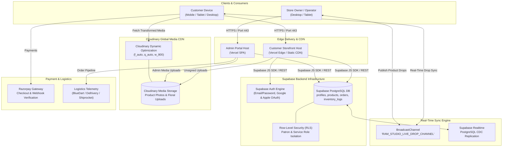
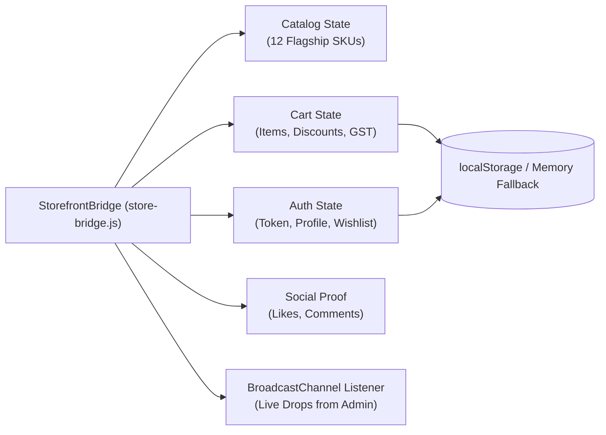
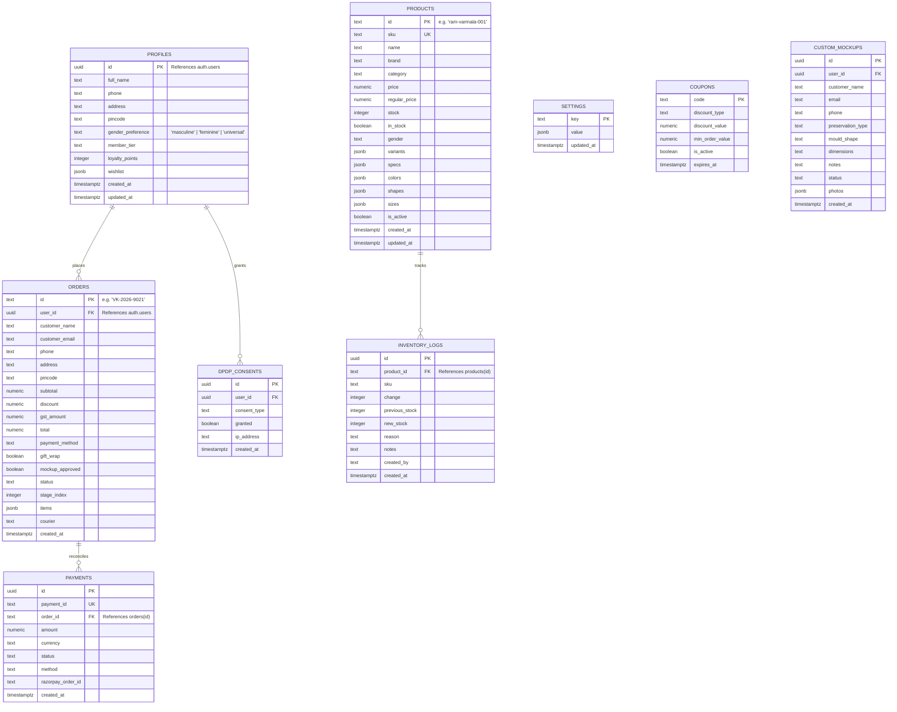
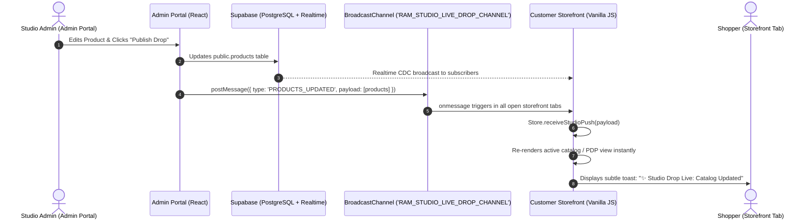

# ARCHITECTURE.md — SYSTEM TOPOLOGY & ENGINEERING BLUEPRINT

> **Ecosystem:** Vistāra Krafts & POTRY Ceramics E-Commerce Platform  
> **Customer Storefront:** `https://vistara-krafts.vercel.app` (Custom domain: `https://vistarakrafts.com`)  
> **Owner Admin Portal:** `https://vistara-krafts-admin.vercel.app`  
> **Backend & Database:** Supabase PostgreSQL 15+ (`supabase/schema.sql`) with Supabase Auth  
> **Media CDN & Storage:** Cloudinary (`cloudinary-config.js` / `storageService.ts`) with responsive auto-optimization  
> **Primary Author:** Antigravity Principal Systems Architect & Super-Designer  
> **Last Updated:** October 2026  

---

## 1. High-Level System Architecture

The platform is designed as a distributed, decoupled e-commerce architecture optimized for extreme client performance, PostgreSQL scalability, and zero admin UI leakage:



---

## 2. Customer Storefront Architecture (`stitch_potry_e_commerce_storefront`)

### 1. Philosophy: Zero-Framework Craft & 120fps Kinetic Physics
The storefront is constructed in pure vanilla JavaScript, HTML5, and CSS Variables. This deliberate architectural choice guarantees:
- **Instant TTI (Time to Interactive):** Near-zero JavaScript bundle parse time.
- **Hardware-Accelerated Fluidity:** 120fps animations executed entirely on GPU-composited properties (`transform`, `opacity`, `backdrop-filter`).
- **Zero Framework Drift:** Completely immune to major version breaking changes in external view libraries.

### 2. State & Engine Architecture (`store-bridge.js`)
State is maintained in a central singleton `StorefrontBridge` (`window.StorefrontBridge` and `window.ResinStore`):

- **Resilience Invariant:** If `localStorage` throws a `QuotaExceededError` or `SecurityError` (e.g. strict Safari Private Browsing mode), the bridge transparently degrades to an in-memory Map, ensuring the cart and checkout never crash.

### 3. View Routing & DOM Reconciliation (`app.js`)
- Client-side hash router handling 7 core views:
  - `#/home` — Brand Hero, 3D Specimen Orb, Pour Calculator, Featured Grid.
  - `#/catalog` — Comprehensive catalog with category and gender filters.
  - `#/custom-studio` — Interactive epoxy casting customizer and volume calculator.
  - `#/social` — Instagram atelier feed (`@resin.art.memories`) with live liking.
  - `#/product/:id` — Kinetic PDP with gallery, optional varieties, and trust badges.
  - `#/cart` — Volume discount tiers, coupon engine, and shipping thresholds.
  - `#/orders` — Track historical studio orders and status progression.
- **Zero Admin Leakage:** The router rejects any admin URLs and strictly renders customer-facing components.

---

## 3. Owner Admin Portal Architecture (`vistara_krafts_admin_portal`)

### 1. Tech Stack
- **Framework:** React 19 + TypeScript (Strict Mode).
- **Build Tool:** Vite 5 (instant HMR and tree-shaken production bundles).
- **Styling:** Tailwind CSS v4 with custom brand tokens matching the 60/30/10 warm gallery aesthetic.
- **Icons:** `lucide-react` (refined 1.5px stroke weight).

### 2. Modular Service Layer Pattern
Every admin domain is abstracted behind a dedicated service module:
```
src/services/
├── authService.ts        # Admin login & Supabase Auth session validation
├── productService.ts     # Products CRUD (Supabase public.products), BroadcastChannel drop
├── inventoryService.ts   # Stock levels & movement logs (Supabase public.inventory_logs)
├── orderService.ts       # Order pipeline status, timeline updates, invoice print
├── customerService.ts    # Customer CRM, lifetime value, loyalty tags (Supabase profiles)
├── storageService.ts     # Cloudinary media storage adapter & image optimization
└── systemService.ts      # Health monitoring for Supabase, Cloudinary, Razorpay, Webhooks
```

### 3. Dual-Mode Mock / Live Adapter Architecture
All services are engineered with an adapter pattern:
- **Development & Staging Mode (`VITE_USE_MOCK_SERVICES=true`):**
  - Uses reactive in-memory state initialized with rich dummy data.
  - Persists changes across browser sessions using isolated admin local storage keys.
  - Broadcasts product updates to customer tabs via `BroadcastChannel`.
- **Production Mode (`VITE_USE_MOCK_SERVICES=false`):**
  - Connects directly to the shared **Supabase PostgreSQL database** via `@supabase/supabase-js`.
  - Authenticates with Supabase Service Role or authenticated Admin JWT.
  - Uploads media directly to **Cloudinary CDN**.

---

## 4. Persistence & Database Topology

### Supabase PostgreSQL 15+ Schema
The system runs on Supabase PostgreSQL defined in [`supabase/schema.sql`](file:///C:/Users/Dell/.gemini/antigravity/scratch/vistara_krafts_admin_portal/supabase/schema.sql):



---

## 5. Real-Time Cross-Application Synchronization

To enable instantaneous live drops without expensive custom WebSocket infrastructure, the system utilizes dual synchronization:
1. **Supabase Realtime (`supabase_realtime` publication):** PostgreSQL CDC (Change Data Capture) broadcasts database mutations across authenticated clients.
2. **Native `BroadcastChannel` API:** Instant browser-level zero-latency communication across open storefront tabs and admin windows on `RAM_STUDIO_LIVE_DROP_CHANNEL`.



---

## 6. Security Architecture & Threat Modeling

1. **Authentication & Session Security:**
   - Managed entirely through **Supabase Auth**. Passwords are encrypted with industry-standard bcrypt/argon2 on Supabase's secure infrastructure.
   - JWT session tokens are signed with asymmetric keys, automatically refreshed via refresh tokens, and transmitted securely over TLS 1.3.
   - 1-Click OAuth via Google and Apple utilizing standard PKCE authorization flows.
2. **Row-Level Security (RLS):**
   - All tables have PostgreSQL Row-Level Security (`ENABLE ROW LEVEL SECURITY`) activated.
   - Products, Settings, and active Coupons are readable by anonymous patrons (`anon`), while only authenticated users can access their own orders and profile data (`auth.uid() = id`).
   - Mutations to products, inventory, and settings are restricted to administrative service roles.
3. **Media Storage Security:**
   - Media uploads utilize **Cloudinary** unsigned upload presets with strict MIME type whitelisting (`image/jpeg`, `image/png`, `image/webp`) and maximum file size thresholds (10MB).
4. **Data Privacy Compliance:**
   - Full compliance with the **Digital Personal Data Protection (DPDP) Act 2023** (explicit customer consent recorded in `public.dpdp_consents`, data export, and complete profile deletion).

---

## 7. Performance & Resilience Guardrails

- **Zero Layout Shift (CLS < 0.05):** Strict aspect ratio constraints and inline image dimensions prevent jarring page reflows.
- **Largest Contentful Paint (LCP < 1.2s):** Pre-rendered critical hero paths and high-priority image fetching.
- **Offline & Network Resilience:**
  - Dynamic network state listener (`navigator.onLine`) triggers a graceful offline banner.
  - Standalone error pages with instant route recovery.
