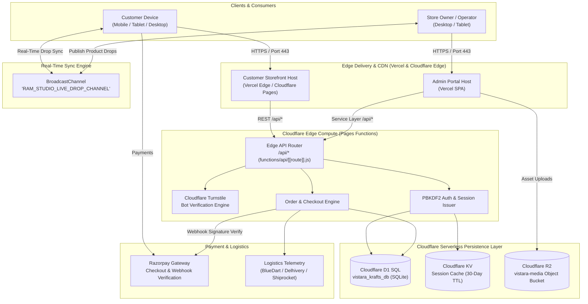
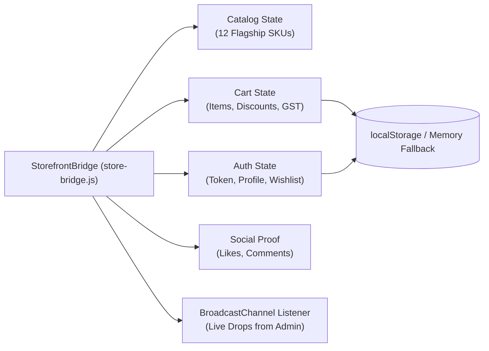
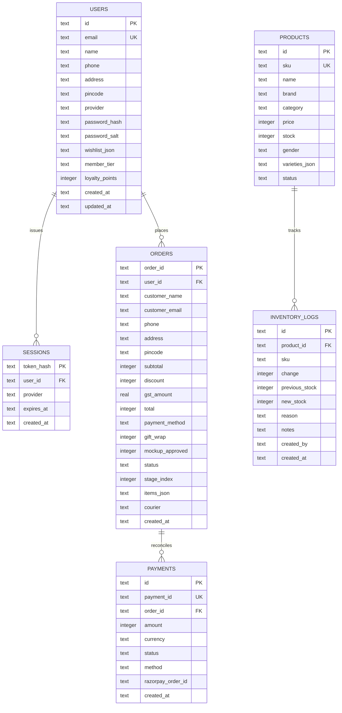
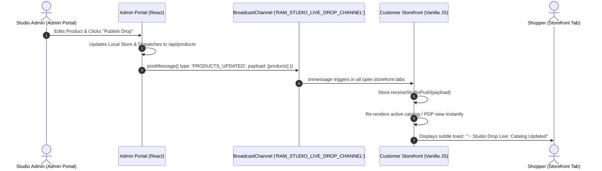

# ARCHITECTURE.md — SYSTEM TOPOLOGY & ENGINEERING BLUEPRINT

> **Ecosystem:** Vistāra Krafts & POTRY Ceramics E-Commerce Platform  
> **Customer Storefront:** `https://vistara-krafts.vercel.app` (Custom domain: `https://vistarakrafts.com`)  
> **Owner Admin Portal:** `https://vistara-krafts-admin.vercel.app`  
> **Cloudflare Edge Gateway:** Pages Functions (`functions/api/[[route]].js`)  
> **Primary Author:** Antigravity Principal Systems Architect & Super-Designer  
> **Last Updated:** October 2026  

---

## 1. High-Level System Architecture

The platform is designed as a distributed, decoupled e-commerce architecture optimized for extreme client performance, edge-compute scalability, and zero admin UI leakage:



---

## 2. Customer Storefront Architecture (`stitch_potry_e_commerce_storefront`)

### 1. Philosophy: Zero-Framework Craft & 120fps Kinetic Physics
The storefront is constructed in pure vanilla JavaScript, HTML5, and CSS Variables. This deliberate architectural choice guarantees:
- **Instant TTI (Time to Interactive):** Near-zero JavaScript bundle parse time.
- **Hardware-Accelerated Fluidity:** 120fps animations executed entirely on GPU-composited properties (`transform`, `opacity`, `backdrop-filter`).
- **Zero Framework Drift:** Completely immune to major version breaking changes in external view libraries.

### 2. State & Engine Architecture (`store-bridge.js`)
State is maintained in a central singleton `StorefrontBridge` (`window.StorefrontBridge` and `window.ResinStore`):

- **Resilience Invariant:** If `localStorage` throws a `QuotaExceededError` or `SecurityError` (e.g. strict Safari Private Browsing mode), the bridge transparently degrades to an in-memory Map, ensuring the cart and checkout never crash.

### 3. View Routing & DOM Reconciliation (`app.js`)
- Client-side hash router handling 7 core views:
  - `#/home` — Brand Hero, 3D Specimen Orb, Pour Calculator, Featured Grid.
  - `#/catalog` — Comprehensive catalog with category and gender filters.
  - `#/custom-studio` — Interactive epoxy casting customizer and volume calculator.
  - `#/social` — Instagram atelier feed (`@resin.art.memories`) with live liking.
  - `#/product/:id` — Kinetic PDP with gallery, optional varieties, and trust badges.
  - `#/cart` — Volume discount tiers, coupon engine, and shipping thresholds.
  - `#/orders` — Track historical studio orders and status progression.
- **Zero Admin Leakage:** The router rejects any admin URLs and strictly renders customer-facing components.

---

## 3. Owner Admin Portal Architecture (`vistara_krafts_admin_portal`)

### 1. Tech Stack
- **Framework:** React 19 + TypeScript (Strict Mode).
- **Build Tool:** Vite 5 (instant HMR and tree-shaken production bundles).
- **Styling:** Tailwind CSS v4 with custom brand tokens matching the 60/30/10 warm gallery aesthetic.
- **Icons:** `lucide-react` (refined 1.5px stroke weight).

### 2. Modular Service Layer Pattern
Every admin domain is abstracted behind a dedicated service module:
```
src/services/
├── authService.ts        # Admin login, session validation, logout
├── productService.ts     # Products CRUD, search, filter, BroadcastChannel drop
├── inventoryService.ts   # Stock levels, movement logs, reason-coded adjustments
├── orderService.ts       # Order pipeline status, timeline updates, invoice print
├── customerService.ts    # Customer CRM, lifetime value, loyalty tags
├── storageService.ts     # Cloudflare R2 presigned upload simulation & mime validation
└── systemService.ts      # Cloudflare edge health, database latency telemetry
```

### 3. Dual-Mode Mock / Live Adapter Architecture
All services are engineered with an adapter pattern:
- **Development & Staging Mode (`VITE_USE_MOCK_SERVICES=true`):**
  - Uses reactive in-memory state initialized with rich dummy data.
  - Persists changes across browser sessions using isolated admin local storage keys.
  - Broadcasts product updates to customer tabs via `BroadcastChannel`.
- **Production Mode (`VITE_USE_MOCK_SERVICES=false`):**
  - Dispatches standard `fetch()` HTTP requests to the Cloudflare Pages Function `/api/*` routes.
  - Transmits Bearer tokens and handles HTTP 401/403 session expiration automatically.

---

## 4. Edge Persistence & Database Topology

### Cloudflare D1 Serverless SQL Schema
The system runs on Cloudflare D1 (serverless SQLite at the edge) defined in `cloudflare/schema.sql`:



---

## 5. Real-Time Cross-Application Synchronization

To enable instantaneous live drops without expensive WebSocket infrastructure, the system utilizes the browser's native **`BroadcastChannel` API**:



---

## 6. Security Architecture & Threat Modeling

1. **Authentication Security:**
   - Client passwords are never stored in plaintext. Passwords undergo **PBKDF2** key derivation with 50,000 SHA-256 iterations and a unique 16-character cryptographic salt.
   - Session tokens are issued using cryptographically secure UUIDs (`crypto.randomUUID()`), hashed with SHA-256 before storage in D1 and KV.
2. **Bot Deterrence & Abuse Prevention:**
   - Registration and checkout endpoints require validation through **Cloudflare Turnstile**.
   - Requests lacking a valid Turnstile token are rejected at the edge with HTTP 403.
3. **Cross-Origin & Header Policy:**
   - Strict CORS configuration whitelisting the production domains:
     - `https://vistara-krafts.vercel.app`
     - `https://vistara-krafts-admin.vercel.app`
     - `https://vistarakrafts.com`
   - `Cross-Origin-Opener-Policy: same-origin-allow-popups` enabled to support 1-Click Google and Apple OAuth popups.
4. **Data Privacy Compliance:**
   - Complete compliance with the **Digital Personal Data Protection (DPDP) Act 2023** (explicit customer consent, clear privacy policies, data erasure capability).

---

## 7. Performance & Resilience Guardrails

- **Zero Layout Shift (CLS < 0.05):** Strict aspect ratio constraints and inline image dimensions prevent jarring page reflows.
- **Largest Contentful Paint (LCP < 1.2s):** Pre-rendered critical hero paths and high-priority image fetching.
- **Offline & Network Resilience:**
  - Dynamic network state listener (`navigator.onLine`) triggers a graceful offline banner.
  - Dedicated `404.html` and `500.html` standalone fallback pages with instant route recovery.
