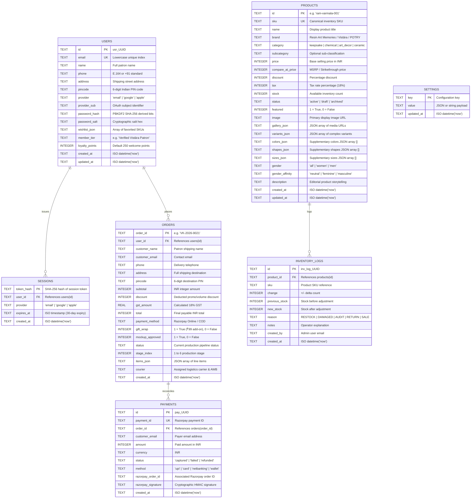

# DATABASE SCHEMA — CLOUDFLARE D1 (SQLITE DIALECT)

> **Database Engine:** Cloudflare D1 Serverless SQL (SQLite 3 compatible)  
> **Primary Database Name:** `vistara_krafts_db`  
> **Schema File:** `cloudflare/schema.sql`  
> **Migration CLI:** Wrangler v3 (`npx wrangler d1 execute`)  
> **Primary Author:** Antigravity Principal Systems Architect & Super-Designer  
> **Last Updated:** October 2026  

---

## 1. Entity-Relationship Architecture



---

## 2. Complete SQL DDL Implementation (`cloudflare/schema.sql`)

```sql
-- ============================================================================
-- Vistāra Krafts — Cloudflare D1 Serverless SQL Schema
-- Local Execution:  npx wrangler d1 execute vistara_krafts_db --local --file=./cloudflare/schema.sql
-- Prod Execution:   npx wrangler d1 execute vistara_krafts_db --remote --file=./cloudflare/schema.sql
-- ============================================================================

-- 1. Users Table (Patrons & Customers)
CREATE TABLE IF NOT EXISTS users (
  id TEXT PRIMARY KEY,
  email TEXT NOT NULL UNIQUE,
  name TEXT NOT NULL DEFAULT '',
  phone TEXT NOT NULL DEFAULT '',
  address TEXT NOT NULL DEFAULT '',
  pincode TEXT NOT NULL DEFAULT '',
  provider TEXT NOT NULL DEFAULT 'email', -- 'email' | 'google' | 'apple'
  provider_sub TEXT DEFAULT '',
  password_hash TEXT DEFAULT '',
  password_salt TEXT DEFAULT '',
  wishlist_json TEXT NOT NULL DEFAULT '[]',
  member_tier TEXT DEFAULT 'Verified Vistāra Patron',
  loyalty_points INTEGER DEFAULT 250,
  created_at TEXT NOT NULL DEFAULT (datetime('now')),
  updated_at TEXT NOT NULL DEFAULT (datetime('now'))
);

CREATE INDEX IF NOT EXISTS idx_users_email ON users(email);

-- 2. Sessions Table (Edge Auth Tokens)
CREATE TABLE IF NOT EXISTS sessions (
  token_hash TEXT PRIMARY KEY,
  user_id TEXT NOT NULL,
  provider TEXT NOT NULL DEFAULT 'email',
  expires_at TEXT NOT NULL,
  created_at TEXT NOT NULL DEFAULT (datetime('now')),
  FOREIGN KEY (user_id) REFERENCES users(id) ON DELETE CASCADE
);

CREATE INDEX IF NOT EXISTS idx_sessions_user ON sessions(user_id);
CREATE INDEX IF NOT EXISTS idx_sessions_expiry ON sessions(expires_at);

-- 3. Orders Table
CREATE TABLE IF NOT EXISTS orders (
  order_id TEXT PRIMARY KEY,
  user_id TEXT NOT NULL,
  customer_name TEXT NOT NULL,
  customer_email TEXT NOT NULL,
  phone TEXT NOT NULL,
  address TEXT NOT NULL,
  pincode TEXT NOT NULL DEFAULT '',
  subtotal INTEGER NOT NULL,
  discount INTEGER NOT NULL DEFAULT 0,
  gst_amount REAL NOT NULL DEFAULT 0,
  total INTEGER NOT NULL,
  payment_method TEXT NOT NULL,
  gift_wrap INTEGER NOT NULL DEFAULT 1,
  mockup_approved INTEGER NOT NULL DEFAULT 0,
  status TEXT NOT NULL DEFAULT 'Order Confirmed • Studio Batch Allocated',
  stage_index INTEGER NOT NULL DEFAULT 1,
  items_json TEXT NOT NULL,
  courier TEXT NOT NULL DEFAULT 'BlueDart Priority Air • AWB Pending',
  created_at TEXT NOT NULL DEFAULT (datetime('now')),
  FOREIGN KEY (user_id) REFERENCES users(id)
);

CREATE INDEX IF NOT EXISTS idx_orders_user ON orders(user_id);
CREATE INDEX IF NOT EXISTS idx_orders_created ON orders(created_at);

-- 4. Products Table (Catalog & Varieties)
CREATE TABLE IF NOT EXISTS products (
  id TEXT PRIMARY KEY,
  sku TEXT NOT NULL UNIQUE,
  name TEXT NOT NULL,
  brand TEXT NOT NULL DEFAULT 'Vistāra Krafts',
  category TEXT NOT NULL DEFAULT 'keepsake',
  subcategory TEXT DEFAULT '',
  price INTEGER NOT NULL,
  compare_at_price INTEGER DEFAULT 0,
  discount INTEGER DEFAULT 0,
  tax INTEGER DEFAULT 18,
  stock INTEGER NOT NULL DEFAULT 0,
  status TEXT NOT NULL DEFAULT 'active',
  featured INTEGER NOT NULL DEFAULT 0,
  image TEXT NOT NULL,
  gallery_json TEXT NOT NULL DEFAULT '[]',
  variants_json TEXT NOT NULL DEFAULT '[]',
  colors_json TEXT NOT NULL DEFAULT '[]',
  shapes_json TEXT NOT NULL DEFAULT '[]',
  sizes_json TEXT NOT NULL DEFAULT '[]',
  gender TEXT NOT NULL DEFAULT 'all', -- 'all' | 'women' | 'men'
  gender_affinity TEXT DEFAULT 'neutral', -- 'neutral' | 'feminine' | 'masculine'
  description TEXT DEFAULT '',
  created_at TEXT NOT NULL DEFAULT (datetime('now')),
  updated_at TEXT NOT NULL DEFAULT (datetime('now'))
);

CREATE INDEX IF NOT EXISTS idx_products_sku ON products(sku);
CREATE INDEX IF NOT EXISTS idx_products_category ON products(category);
CREATE INDEX IF NOT EXISTS idx_products_gender ON products(gender);

-- 5. Inventory Movement Audit Logs
CREATE TABLE IF NOT EXISTS inventory_logs (
  id TEXT PRIMARY KEY,
  product_id TEXT NOT NULL,
  sku TEXT NOT NULL,
  change INTEGER NOT NULL,
  previous_stock INTEGER NOT NULL,
  new_stock INTEGER NOT NULL,
  reason TEXT NOT NULL, -- 'RESTOCK' | 'DAMAGED' | 'AUDIT' | 'RETURN' | 'SALE'
  notes TEXT DEFAULT '',
  created_by TEXT NOT NULL DEFAULT 'system',
  created_at TEXT NOT NULL DEFAULT (datetime('now')),
  FOREIGN KEY (product_id) REFERENCES products(id)
);

CREATE INDEX IF NOT EXISTS idx_inventory_product ON inventory_logs(product_id);
CREATE INDEX IF NOT EXISTS idx_inventory_sku ON inventory_logs(sku);

-- 6. Payments Reconciliation Table
CREATE TABLE IF NOT EXISTS payments (
  id TEXT PRIMARY KEY,
  payment_id TEXT NOT NULL UNIQUE,
  order_id TEXT NOT NULL,
  customer_email TEXT NOT NULL,
  amount INTEGER NOT NULL,
  currency TEXT NOT NULL DEFAULT 'INR',
  status TEXT NOT NULL DEFAULT 'captured', -- 'captured' | 'failed' | 'refunded'
  method TEXT NOT NULL DEFAULT 'upi',
  razorpay_order_id TEXT DEFAULT '',
  razorpay_signature TEXT DEFAULT '',
  created_at TEXT NOT NULL DEFAULT (datetime('now')),
  FOREIGN KEY (order_id) REFERENCES orders(order_id)
);

CREATE INDEX IF NOT EXISTS idx_payments_order ON payments(order_id);
CREATE INDEX IF NOT EXISTS idx_payments_rzp ON payments(payment_id);

-- 7. Platform Settings Key-Value Table
CREATE TABLE IF NOT EXISTS settings (
  key TEXT PRIMARY KEY,
  value TEXT NOT NULL,
  updated_at TEXT NOT NULL DEFAULT (datetime('now'))
);
```

---

## 3. Seed Data Specification (12 Flagship Products)

To seed initial catalog records into Cloudflare D1:
```sql
INSERT OR IGNORE INTO products (
  id, sku, name, brand, category, price, compare_at_price, stock, status, featured,
  image, colors_json, shapes_json, sizes_json, gender, gender_affinity, description
) VALUES
(
  'ram-varmala-001', 'ram-varmala-001', 'Eternal Varmala 50mm Floral Keepsake Block',
  'Resin Art Memories', 'keepsake', 4499, 5499, 18, 'active', 1,
  'https://images.unsplash.com/photo-1544716278-ca5e3f4abd8c?w=1000&q=90',
  '["Royal Gold", "Champagne Rose"]', '["Mughal Arch", "Hexagon", "Circle"]', '["6-inch Desk", "12-inch Royal"]',
  'women', 'feminine', 'Handcrafted 50mm diamond crystal keepsake block preserving wedding varmalas forever.'
),
(
  'vk-epx-301', 'vk-epx-301', 'UltraClear 3:1 Optical Casting Resin Kit (1.2kg)',
  'Vistāra Krafts', 'chemical', 1299, 1599, 42, 'active', 1,
  'https://images.unsplash.com/photo-1579783902614-a3fb3927b675?w=1000&q=90',
  '[]', '[]', '[]',
  'all', 'neutral', 'ISO-9001 certified 3:1 optical epoxy system formulated with HALS UV stabilizers.'
);
```

---

## 4. Operational Runbook: Wrangler CLI Commands

### 1. Execute Schema on Local Development D1
```bash
npx wrangler d1 execute vistara_krafts_db --local --file=./cloudflare/schema.sql
```

### 2. Execute Schema on Remote Production Cloudflare D1
```bash
npx wrangler d1 execute vistara_krafts_db --remote --file=./cloudflare/schema.sql
```

### 3. Query Users in Production D1
```bash
npx wrangler d1 execute vistara_krafts_db --remote --command="SELECT id, email, name, provider, member_tier FROM users LIMIT 10;"
```

### 4. Create Automated Database Backup
```bash
npx wrangler d1 export vistara_krafts_db --remote --output=./backup_$(date +%Y%m%d).sql
```
