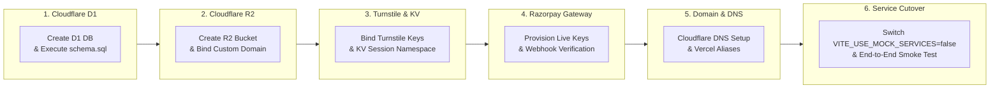

# INTEGRATION PLAN — PRODUCTION INFRASTRUCTURE CUTOVER

> **Objective:** Step-by-step technical blueprint for activating real Cloudflare D1, R2, KV, Turnstile, and Razorpay production credentials without code redesign.  
> **Target Production Domains:**  
> - Customer Storefront: `https://vistara-krafts.vercel.app` → `https://vistarakrafts.com`  
> - Owner Admin Portal: `https://vistara-krafts-admin.vercel.app` → `https://admin.vistarakrafts.com`  
> - Edge Storage CDN: `https://media.vistarakrafts.com`  
> **Last Updated:** October 2026  

---

## 1. Production Integration Overview

The platform is designed with a **Ready-to-Connect Service Architecture**. The entire UI, logic, form validation, and state machines are 100% complete. Transitioning to production requires zero frontend rewriting—only provisioning Cloudflare and Razorpay credentials and flipping configuration flags.



---

## 2. Phase 1: Cloudflare D1 Serverless SQL Provisioning

### Step 1.1: Create Remote Database
Execute using Wrangler CLI inside the project directory:
```bash
npx wrangler d1 create vistara_krafts_db
```
*Note the output `database_id` (e.g. `xxxxxxxx-xxxx-xxxx-xxxx-xxxxxxxxxxxx`).*

### Step 1.2: Update `wrangler.toml` Bindings
Ensure `stitch_potry_e_commerce_storefront/wrangler.toml` contains the exact database ID:
```toml
[[d1_databases]]
binding = "VISTARA_DB"
database_name = "vistara_krafts_db"
database_id = "YOUR_ACTUAL_CLOUDFLARE_D1_DATABASE_ID"
```

### Step 1.3: Apply Database Schema DDL
Execute the canonical schema remotely:
```bash
npx wrangler d1 execute vistara_krafts_db --remote --file=./cloudflare/schema.sql
```

### Step 1.4: Verify Table Creation
```bash
npx wrangler d1 execute vistara_krafts_db --remote --command="SELECT name FROM sqlite_master WHERE type='table';"
```
*Expected tables:* `users`, `sessions`, `orders`, `products`, `inventory_logs`, `payments`, `settings`.

---

## 3. Phase 2: Cloudflare R2 Object Storage Setup

### Step 2.1: Provision R2 Bucket
```bash
npx wrangler r2 bucket create vistara-media
```

### Step 2.2: Configure CORS Policy
Create a file `r2-cors.json`:
```json
[
  {
    "AllowedOrigins": [
      "https://vistara-krafts.vercel.app",
      "https://vistara-krafts-admin.vercel.app",
      "https://vistarakrafts.com",
      "https://admin.vistarakrafts.com",
      "http://localhost:5173"
    ],
    "AllowedMethods": ["GET", "PUT", "POST", "DELETE", "HEAD"],
    "AllowedHeaders": ["*"],
    "MaxAgeSeconds": 3600
  }
]
```
Apply CORS to the bucket:
```bash
npx wrangler r2 bucket cors set vistara-media --file=./r2-cors.json
```

### Step 2.3: Connect Public Custom Domain
1. In Cloudflare Dashboard → R2 → `vistara-media` → Settings → Public Access.
2. Click **Connect Domain** and bind `media.vistarakrafts.com`.
3. Cloudflare will automatically provision edge SSL certificates.

---

## 4. Phase 3: Cloudflare Turnstile & KV Session Store

### Step 3.1: Turnstile Bot Verification Setup
1. In Cloudflare Dashboard → Turnstile → **Add Site**.
2. Domain: `vistarakrafts.com` and `vistara-krafts.vercel.app`.
3. Mode: Managed (non-interactive checkbox).
4. Save the **Site Key** and **Secret Key**.

### Step 3.2: Create Session KV Namespace
```bash
npx wrangler kv:namespace create VISTARA_SESSIONS
```
Add the output namespace ID to `wrangler.toml`:
```toml
[[kv_namespaces]]
binding = "VISTARA_SESSIONS"
id = "YOUR_KV_NAMESPACE_ID"
```

---

## 5. Phase 4: Razorpay Payment Gateway Integration

### Step 4.1: Retrieve API Credentials
1. Log into [Razorpay Dashboard](https://dashboard.razorpay.com).
2. Navigate to **Settings** → **API Keys**.
3. Generate Live API Keys:
   - `Key Id`: `rzp_live_xxxxxxxxxxxx`
   - `Key Secret`: `xxxxxxxxxxxxxxxxxxxxxxxx`

### Step 4.2: Configure Webhook
1. In Razorpay Dashboard → **Settings** → **Webhooks** → **Add New Webhook**.
2. Webhook URL: `https://vistara-krafts.vercel.app/api/webhooks/razorpay`.
3. Secret: Create a secure random string (e.g., `rzp_sec_v1stara_2026`).
4. Active Events:
   - `order.paid`
   - `payment.captured`
   - `payment.failed`
   - `refund.processed`

---

## 6. Phase 5: Domain & DNS Configuration (`vistarakrafts.com`)

### Step 5.1: Point DNS to Cloudflare
Set registrar nameservers to Cloudflare:
- `ns1.cloudflare.com`
- `ns2.cloudflare.com`

### Step 5.2: Configure DNS Records
| Type | Name | Target | Proxy Status |
| :--- | :--- | :--- | :--- |
| `CNAME` | `@` | `cname.vercel-dns.com` | DNS Only (Gray Cloud) |
| `CNAME` | `www` | `cname.vercel-dns.com` | DNS Only (Gray Cloud) |
| `CNAME` | `admin` | `cname.vercel-dns.com` | DNS Only (Gray Cloud) |
| `CNAME` | `media` | `vistara-media.r2.cloudflarestorage.com` | Proxied (Orange Cloud) |

---

## 7. Phase 6: Admin Portal & Storefront Cutover

### Step 6.1: Update Vercel Environment Variables
Set these variables in the respective Vercel project dashboards:

#### Storefront Project (`vistara-krafts`)
```env
TURNSTILE_SITE_KEY=0x4AAAAAA...
TURNSTILE_SECRET_KEY=0x4AAAAAA...
VITE_RAZORPAY_KEY_ID=rzp_live_...
RAZORPAY_KEY_SECRET=...
SITE_URL=https://vistarakrafts.com
ENVIRONMENT=production
```

#### Admin Portal Project (`vistara-krafts-admin`)
```env
VITE_USE_MOCK_SERVICES=false
VITE_API_URL=https://vistara-krafts.vercel.app/api
VITE_RAZORPAY_KEY_ID=rzp_live_...
VITE_R2_PUBLIC_DOMAIN=https://media.vistarakrafts.com
```

### Step 6.2: End-to-End Verification Checklist
```markdown
- [ ] 1. Load https://vistarakrafts.com (Storefront renders in < 1.2s, 0 console errors)
- [ ] 2. Register a new patron account with Turnstile challenge verification
- [ ] 3. Verify user row created in Cloudflare D1: SELECT * FROM users
- [ ] 4. Add "UltraClear 3:1 Resin" to Studio Bag and proceed to Razorpay test checkout
- [ ] 5. Complete payment and verify order row created in D1: SELECT * FROM orders
- [ ] 6. Log into Admin Portal (https://admin.vistarakrafts.com)
- [ ] 7. Confirm real-time order appears in Orders table
- [ ] 8. Advance order stage to "In Transit" and verify customer view updates
- [ ] 9. Upload high-res product photo via Admin Product Modal and verify asset in R2
- [ ] 10. Adjust stock by +10 units and verify inventory_logs audit record
```
