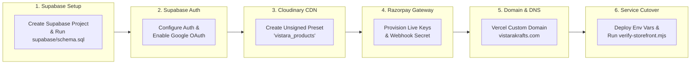

# INTEGRATION PLAN — PRODUCTION INFRASTRUCTURE CUTOVER

> **Objective:** Step-by-step technical blueprint for activating real Supabase, Cloudinary, and Razorpay production credentials without code redesign.  
> **Target Production Domains:**  
> - Customer Storefront: `https://vistara-krafts.vercel.app` → `https://vistarakrafts.com`  
> - Owner Admin Portal: `https://vistara-krafts-admin.vercel.app` (Custom domain to be announced by owner)  
> **Backend & Database:** Supabase PostgreSQL 15+ (`supabase/schema.sql`) with Supabase Auth  
> **Media CDN & Storage:** Cloudinary (`storageService.ts` / `cloudinary-config.js`)  
> **Payment Gateway:** Razorpay  
> **Last Updated:** October 2026  

---

## 1. Production Integration Overview

The platform is designed with a **Ready-to-Connect Modular Architecture**. The entire UI, logic, form validation, state management, and error handling are 100% complete and verified. Transitioning to production requires zero frontend rewriting—only provisioning credentials in the Supabase, Cloudinary, and Razorpay dashboards and setting environment variables in Vercel.

---

## 2. Phase 1: Supabase Project & PostgreSQL Schema Setup

### Step 1.1: Create Remote Supabase Project
1. Log into the [Supabase Dashboard](https://supabase.com/dashboard).
2. Click **New Project**, select organization, and set:
   - **Project Name:** `vistara-krafts-production`
   - **Database Password:** Store securely in password vault.
   - **Region:** `ap-south-1` (Mumbai, India) for lowest latency to Indian patrons.

### Step 1.2: Execute Database DDL
1. Open the Supabase **SQL Editor**.
2. Paste the contents of [`supabase/schema.sql`](file:///C:/Users/Dell/.gemini/antigravity/scratch/vistara_krafts_admin_portal/supabase/schema.sql).
3. Click **Run**.
4. Verify that the 8 production tables are created:
   - `public.profiles`
   - `public.products`
   - `public.orders`
   - `public.inventory_logs`
   - `public.payments`
   - `public.settings`
   - `public.coupons`
   - `public.dpdp_consents`

### Step 1.3: Enable Realtime Replication
In Supabase Dashboard under **Database** → **Replication**, confirm that the `supabase_realtime` publication includes:
- `public.products`
- `public.orders`
- `public.inventory_logs`

---

## 3. Phase 2: Supabase Auth Configuration

### Step 2.1: Email & Password Auth
1. Go to **Authentication** → **Providers** → **Email**.
2. Ensure **Enable Email provider** is turned ON.
3. Configure **Confirm email** according to business requirements (enabled for verified patrons).

### Step 2.2: Google OAuth Configuration
1. In [Google Cloud Console](https://console.cloud.google.com), create an OAuth 2.0 Client ID.
2. Under **Authorized redirect URIs**, add:
   - `https://<YOUR_PROJECT_REF>.supabase.co/auth/v1/callback`
3. In Supabase Dashboard, enable **Google** provider and enter:
   - **Client ID**
   - **Client Secret**

### Step 2.3: Redirect URLs
Under **Authentication** → **URL Configuration**, set:
- **Site URL:** `https://vistarakrafts.com`
- **Additional Redirect URLs:**
  - `https://vistara-krafts.vercel.app`
  - `https://vistara-krafts.vercel.app/**`
  - `https://vistarakrafts.com/**`
  - `https://vistara-krafts-admin.vercel.app`
  - `https://vistara-krafts-admin.vercel.app/**`

---

## 4. Phase 3: Cloudinary Media Storage Setup

### Step 3.1: Cloudinary Account & Cloud Name
1. Sign in to the [Cloudinary Console](https://cloudinary.com/console).
2. Copy your **Cloud Name** (e.g. `vistara-krafts`).

### Step 3.2: Create Unsigned Upload Preset
1. Go to **Settings** → **Upload** → **Upload presets**.
2. Click **Add upload preset**:
   - **Preset name:** `vistara_products` (and `vistara_keepsakes` for user floral uploads).
   - **Signing Mode:** `Unsigned`.
   - **Folder:** `vistara-products`.
   - **Allowed formats:** `jpg, png, webp, gif`.
   - **Max file size:** `10 MB`.
3. Save the preset.

---

## 5. Phase 4: Razorpay Payment Gateway Provisioning

### Step 4.1: Retrieve API Keys
1. Log into the [Razorpay Dashboard](https://dashboard.razorpay.com).
2. Go to **Settings** → **API Keys** → **Generate Live Key**.
3. Copy:
   - **Key ID:** `rzp_live_xxxxxxxxxxxxxx`
   - **Key Secret:** Securely store for server-side webhook verification.

### Step 4.2: Webhook Configuration
1. In Razorpay Dashboard, navigate to **Settings** → **Webhooks**.
2. Add Webhook endpoint: `https://<PROJECT_REF>.supabase.co/functions/v1/razorpay-webhook`.
3. Subscribe to events:
   - `payment.captured`
   - `payment.failed`
   - `order.paid`
4. Enter a strong secret string and record it as `RAZORPAY_WEBHOOK_SECRET`.

---

## 6. Phase 5: Domain & DNS Configuration

### Customer Storefront (`vistarakrafts.com`)
1. In the Vercel dashboard for `vistara-krafts`, open **Settings** → **Domains**.
2. Add `vistarakrafts.com` and `www.vistarakrafts.com`.
3. In your domain registrar (GoDaddy, Namecheap, Cloudflare Registrar), configure DNS:
   | Type | Name | Value | TTL |
   | :--- | :--- | :--- | :--- |
   | `A` | `@` | `76.76.21.21` | Auto / 300 |
   | `CNAME` | `www` | `cname.vercel-dns.com` | Auto / 300 |
4. Vercel automatically issues an SSL certificate via Let's Encrypt.

### Owner Admin Portal
Configured on Vercel (`vistara-krafts-admin.vercel.app`), with custom domain configured when owner provides domain choice.

---

## 7. Phase 6: Environment Variables & Verification Checklist

### Vercel Environment Variables Matrix

#### Customer Storefront (`stitch_potry_e_commerce_storefront`)
| Variable | Value Description | Public/Private |
| :--- | :--- | :--- |
| `VITE_SUPABASE_URL` | `https://<PROJECT_REF>.supabase.co` | Public |
| `VITE_SUPABASE_ANON_KEY` | Public anonymous JWT key | Public |
| `VITE_CLOUDINARY_CLOUD_NAME` | Cloudinary cloud identifier | Public |
| `VITE_CLOUDINARY_UPLOAD_PRESET` | `vistara_keepsakes` | Public |
| `VITE_RAZORPAY_KEY_ID` | `rzp_live_xxxxxxxxxxxxxx` | Public |

#### Owner Admin Portal (`vistara_krafts_admin_portal`)
| Variable | Value Description | Public/Private |
| :--- | :--- | :--- |
| `VITE_USE_MOCK_SERVICES` | `false` (Set to activate live Supabase) | Public |
| `VITE_SUPABASE_URL` | `https://<PROJECT_REF>.supabase.co` | Public |
| `VITE_SUPABASE_ANON_KEY` | Public anonymous JWT key | Public |
| `VITE_CLOUDINARY_CLOUD_NAME` | Cloud Name | Public |
| `VITE_CLOUDINARY_UPLOAD_PRESET` | `vistara_products` | Public |
| `VITE_RAZORPAY_KEY_ID` | `rzp_live_xxxxxxxxxxxxxx` | Public |

---

## 8. Final Go-Live Verification Smoke Test

1. **Catalog Integrity:** Load `https://vistarakrafts.com/#/catalog` — verify all 12 items display with INR pricing and high-res imagery.
2. **Product Varieties:** Edit a product in Admin Portal to add custom colors/sizes; verify changes immediately reflect on the live storefront.
3. **Epoxy Pour Calculator:** Compute a 3:1 pour calculation on `#/custom-studio`; verify correct Part A and Part B weights in grams.
4. **Order Flow:** Place a test order using Razorpay Test Mode; verify order appears instantly in the Admin Portal orders board.
5. **CI/CD Test Runner:** Run `node verify-storefront.mjs` — ensure all 25 test suites pass with 0 failures.
