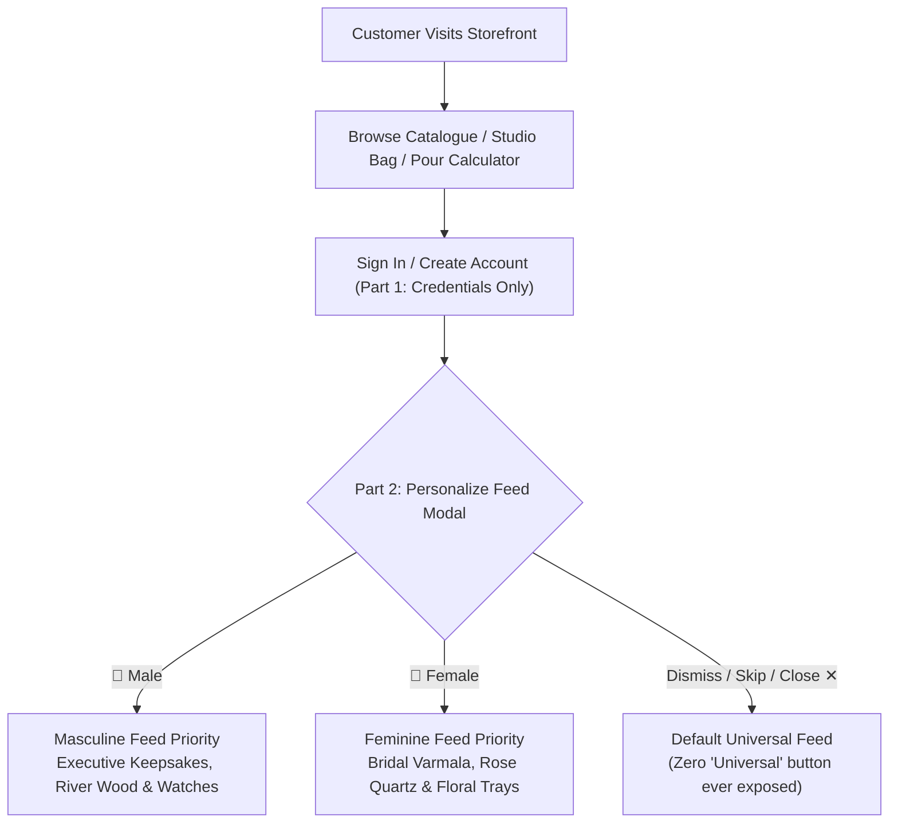

# PROJECT CONTEXT — VISTĀRA KRAFTS & POTRY CERAMICS

> **Brand Identity:** Vistāra Krafts Studio & Chemical Atelier (`@resin.art.memories`)  
> **Sister Brand:** POTRY Contemporary Ceramic Studio  
> **Headquarters & Studio:** 42 Craft Enclave, Indiranagar 100 Feet Road, Bengaluru, Karnataka, India (560001)  
> **Customer Storefront:** `https://vistara-krafts.vercel.app` (Custom Domain: `https://vistarakrafts.com`)  
> **Owner Admin Portal:** `https://vistara-krafts-admin.vercel.app`  
> **Primary Domains:** Bridal Keepsake Preservation, Optical Epoxy Chemical Formulation, Contemporary Ceramic Homeware, Enterprise E-Commerce Operations  

---

## 1. Brand Heritage & Vision

**Vistāra Krafts** is India’s foremost bridal varmala memory preservation studio and an ISO 9001:2015 certified manufacturer of high-purity optical epoxy casting systems. Operating primarily through its Instagram atelier (`@resin.art.memories`), the studio transforms perishable wedding garlands (*varmalas* / *jaimalas*), anniversary bouquets, and sacred celebration florals into forever-lasting, diamond-clear acrylic-epoxy crystal blocks.

Recognizing that customers frequently seek complementary tactile home décor, the brand integrates **POTRY**, an artisanal ceramic studio crafting stoneware pitchers, wabi-sabi planters, and textured tableware.

### Core Business Pillars
1. **Bespoke Memory Preservation:** White-glove floral dehydration, colour restoration, multi-layer bubble-free casting under pressure chambers, and diamond polishing.
2. **Speciality Chemical Supply:** Laboratory-formulated, non-yellowing epoxy systems (3:1 casting, 2:1 deep pour, 1:1 topcoat, and 1-part UV resin) for Indian artists, architects, and woodworkers.
3. **Curated Gifting & Tactile Décor:** Ready-to-ship ocean resin trays, geode wall art, and POTRY ceramic tableware.
4. **Autonomous Owner Administration:** An enterprise-grade, high-craft administration portal giving studio founders full control over revenue, inventory movements, order workflows, and customer relationships.

---

## 2. Dual-Platform Ecosystem Architecture

The Vistāra Krafts platform is engineered as two completely decoupled, complementary web applications:

```mermaid
flowchart LR
    subgraph Storefront ["1. Customer Storefront (Vercel / Cloudflare Pages)"]
        A["Awwwards-Level UI & 120fps Kinetic Physics"]
        B["Interactive Epoxy Pour Calculator (3:1, 2:1, 1:1)"]
        C["Two-Part Auth & Gender Curation Flow"]
        D["1-Click Guest & Registered Checkout"]
        E["DPDP Act 2023 Consent & Indian PIN Verification"]
    end

    subgraph AdminPortal ["2. Owner Admin Portal (Vercel)"]
        F["Real-Time Executive Revenue Dashboard"]
        G["Product Catalog CRUD + R2 Media Storage"]
        H["Supplementary Varieties (Colors, Shapes, Sizes)"]
        I["Inventory Movement Ledger & Stock Adjustments"]
        J["Order Fulfillment Pipeline & GST Invoices"]
        K["Customer CRM & Razorpay Ledger"]
    end

    Storefront <-->|"Real-Time Drops (BroadcastChannel) & Edge API (/api/*)"| AdminPortal
```

---

## 3. Customer Personas & Feed Personalization Model

To streamline purchasing and maximize gifting conversion, Vistāra Krafts implements an intelligent **Two-Part Curation Architecture**:

### Personas Defined

#### 1. Curated for Him (`masculine`)
- **Target Products:** Deep Pour river tables (`vk-epx-201`), geometric watch keepsakes, executive resin coasters, dark obsidian finishes, and POTRY charcoal planters (`potry-ceramic-002`).
- **Gifting Occasions:** Groom's boutonniere preservation, corporate anniversary gifts, housewarming décor.

#### 2. Curated for Her (`feminine`)
- **Target Products:** Eternal 50mm Varmala Blocks (`ram-varmala-001`), Rose Quartz Preservation Trays (`ram-varmala-002`), Amethyst Geode Wall Art (`vk-geode-001`), and blush ceramic tableware.
- **Gifting Occasions:** Wedding garland preservation, bridal shower keepsakes, festive home styling.

#### 3. Universal Stage (`all` — Silent Default)
- **Constraint:** The user must **never** see a button or tab labeled "Universal". If the customer chooses neither `👔 Male` nor `🌸 Female` (e.g., closes modal or clicks *"Skip for Now & Continue"*), they remain in this balanced, un-skewed state.

---

## 4. Master Product Catalogue (12 Flagship SKUs)

The catalog consists of 12 master products spanning three distinct product lines:

| SKU | Product Title | Brand | Category | Affinity | Base Price (INR) | Key Feature |
| :--- | :--- | :--- | :--- | :--- | :--- | :--- |
| `ram-varmala-001` | Eternal Varmala 50mm Floral Keepsake Block | Resin Art Memories | Keepsake | Feminine | ₹4,499 | 50mm diamond crystal, 3-layer UV seal |
| `ram-varmala-002` | Bridal Rose Quartz Floral Preservation Tray | Resin Art Memories | Keepsake | Feminine | ₹5,999 | Genuine rose quartz chips, gold leaf handles |
| `vk-epx-301` | UltraClear 3:1 Optical Casting Resin Kit (1.2kg) | Vistāra Krafts | Chemical | Unisex | ₹1,299 | ISO-9001, HALS UV stabilizer, bubble-release |
| `vk-epx-201` | Deep Pour 2:1 River Table Epoxy System (3kg) | Vistāra Krafts | Chemical | Masculine | ₹2,899 | Pours up to 50mm per layer without exotherm |
| `vk-epx-101` | High-Gloss 1:1 Doming & Topcoat Resin (1kg) | Vistāra Krafts | Chemical | Unisex | ₹1,099 | Scratch-resistant 90 Shore D surface |
| `vk-epx-uv01` | Instant Solar Fast-Cure UV Resin (250g) | Vistāra Krafts | Chemical | Unisex | ₹649 | Cures in 90s under 365nm UV LED |
| `vk-geode-001` | Amethyst & Crushed Quartz Resin Geode Wall Art | Vistāra Krafts | Art Décor | Feminine | ₹8,499 | Hand-crushed crystals, metallic mica veins |
| `vk-ocean-001` | Pacific Teakwood Ocean Wave Resin Serving Board | Vistāra Krafts | Homeware | Unisex | ₹2,499 | Food-safe FDA compliant resin, aged teak |
| `potry-ceramic-001`| Sienna Ridged Artisan Ceramic Pitcher | POTRY | Ceramic | Feminine | ₹1,899 | Hand-thrown stoneware, terracotta wash |
| `potry-ceramic-002`| Wabi-Sabi Matte Charcoal Ceramic Planter | POTRY | Ceramic | Masculine | ₹1,499 | Textured coarse clay, drainage tray included |
| `potry-ceramic-003`| Terracotta Sunburst Ceramic Incense Plate | POTRY | Ceramic | Unisex | ₹799 | Matte unglazed terracotta, brass holder |
| `potry-varmala-cube`| Heritage Brass & Ceramic Flower Specimen Cube | POTRY x VK | Hybrid | Masculine | ₹3,299 | Ceramic pedestal with encased botanical resin |

---

## 5. Supplementary Product Varieties & Gender Rules

### 1. Varieties are Supplementary & Optional
- Not every product requires variants. In fact, most artisanal keepsakes are one-of-a-kind.
- **Admin Configuration:** The Admin Portal provides 3 optional fields:
  - 🎨 **Colors:** e.g., `Royal Gold, Champagne Rose`
  - 📐 **Shapes:** e.g., `Mughal Arch, Hexagon, Circle`
  - 📏 **Sizes:** e.g., `6-inch Desk, 12-inch Royal`
- **Zero Fallback Rule:** If left blank, the product has no varieties. The storefront does **not** inject dummy options like `"Classic Clear"` or `"Standard Atelier"`. The variety drawer button is completely omitted.

### 2. Gender Targeting
- Every product can be designated as:
  - `✨ Universal (Men & Women)` (Default)
  - `🌸 Mainly for Female / Women`
  - `👔 Mainly for Male / Men`
- Products tagged for specific genders receive subtle visual tags and priority positioning in the curated feed view.

---

## 6. Commercial Pricing, Tax & Discount Rules

1. **Currency:** All monetary values are strictly in Indian Rupees (`INR` / `₹`).
2. **Goods and Services Tax (GST):**
   - Standard 18% GST calculation supported.
   - Prices in catalog are GST-inclusive; invoices split taxable amount and CGST (9%) + SGST (9%) / IGST (18%).
3. **Volume Tier Discounts:**
   - Buying 3+ units of a chemical system: **5% off**.
   - Buying 5+ units: **10% off**.
   - Buying 10+ units: **15% off**.
4. **Free Shipping Threshold:** Orders of ₹1,499 and above qualify for Free Express BlueDart Air Shipping; below ₹1,499, a flat delivery fee of ₹149 is applied.
5. **Luxury Gift Wrapping:** Available as an optional ₹99 add-on, featuring handmade cotton rag paper, wax seal stamp, and handwritten calligraphy note.

---

## 7. Legal, Compliance & Privacy Directives

- **Digital Personal Data Protection (DPDP) Act 2023:**
  - Mandatory consent banner presented on initial storefront entry.
  - Transparent opt-ins for marketing communications and strictly purposeful data storage.
  - Right to erasure and data portability endpoints prepared.
- **Indian Postal PIN Code Validation:**
  - All checkout forms enforce 6-digit Indian postal code format (`^[1-9][0-9]{5}$`).
  - Pre-validates regional courier deliverability (BlueDart / Delhivery priority lanes).
