# PROJECT CONTEXT — VISTĀRA KRAFTS & POTRY CERAMICS

> **Brand Identity:** Vistāra Krafts Studio & Chemical Atelier (`@resin.art.memories`)  
> **Sister Brand:** POTRY Contemporary Ceramic Studio  
> **Headquarters & Studio:** 42 Craft Enclave, Indiranagar 100 Feet Road, Bengaluru, Karnataka, India (560001)  
> **Customer Storefront:** `https://vistara-krafts.vercel.app` (Target Domain: `https://vistarakrafts.com`)  
> **Owner Admin Portal:** `https://vistara-krafts-admin.vercel.app` (Target Domain: To be configured by owner)  
> **Backend & Database:** Supabase PostgreSQL 15+ (`supabase/schema.sql`) with Supabase Auth  
> **Media CDN & Storage:** Cloudinary (`cloudinary-config.js` / `storageService.ts`)  
> **Payment Gateway:** Razorpay (Indian Rupee transactions with automated webhooks)  
> **Primary Domains:** Bridal Keepsake Preservation, Optical Epoxy Chemical Formulation, Contemporary Ceramic Homeware, Enterprise E-Commerce Operations  

---

## 1. Brand Heritage & Vision

**Vistāra Krafts** is India’s premier bridal varmala memory preservation studio and an ISO 9001:2015 certified manufacturer of high-purity optical epoxy casting systems. Operating primarily through its Instagram atelier (`@resin.art.memories`), the studio transforms perishable wedding garlands (*varmalas* / *jaimalas*), anniversary bouquets, and sacred celebration florals into forever-lasting, diamond-clear acrylic-epoxy crystal blocks.

Recognizing that customers frequently seek complementary tactile home décor, the brand integrates **POTRY**, an artisanal ceramic studio crafting stoneware pitchers, wabi-sabi planters, and textured tableware.

### Core Business Pillars
1. **Bespoke Memory Preservation:** White-glove floral dehydration, colour restoration, multi-layer bubble-free casting under pressure chambers, and diamond polishing.
2. **Speciality Chemical Supply:** Laboratory-formulated, non-yellowing epoxy systems (3:1 casting, 2:1 deep pour, 1:1 topcoat, and 1-part UV resin) for Indian artists, architects, and woodworkers.
3. **Curated Gifting & Tactile Décor:** Ready-to-ship ocean resin trays, geode wall art, and POTRY ceramic tableware.
4. **Autonomous Owner Administration:** An enterprise-grade, high-craft administration portal giving studio founders full control over revenue, inventory movements, order workflows, and customer relationships.

---

## 2. Dual-Platform Ecosystem Architecture

The Vistāra Krafts platform is engineered as two completely decoupled, complementary web applications:

```mermaid
flowchart LR
    subgraph Storefront ["1. Customer Storefront (Vercel CDN)"]
        A["Awwwards-Level UI & 120fps Kinetic Physics"]
        B["Interactive Epoxy Pour Calculator (3:1, 2:1, 1:1)"]
        C["Two-Part Auth & Gender Curation Flow"]
        D["1-Click Guest & Registered Checkout"]
        E["DPDP Act 2023 Consent & Indian PIN Verification"]
    end

    subgraph AdminPortal ["2. Owner Admin Portal (Vercel SPA)"]
        F["Real-Time Executive Revenue Dashboard"]
        G["Product Catalog CRUD + Cloudinary Media Engine"]
        H["Supplementary Varieties (Colors, Shapes, Sizes)"]
        I["Inventory Movement Ledger & Stock Adjustments"]
        J["Order Fulfillment Pipeline & GST Invoices"]
        K["Customer CRM & Razorpay Ledger"]
    end

    Storefront <-->|"Real-Time Drops (BroadcastChannel) & Supabase Realtime"| AdminPortal
```

### Architectural Division of Labor
| Capability | Customer Storefront | Owner Admin Portal |
| :--- | :--- | :--- |
| **Primary Audience** | Retail patrons, brides, corporate gifters | Studio founders, operations manager, fulfillment team |
| **Technology Stack** | Vanilla HTML5, ES2022 JavaScript, CSS Variables | React 19, TypeScript (strict), Vite, Tailwind CSS v4, Lucide Icons |
| **Hosting** | Vercel Static CDN (`https://vistara-krafts.vercel.app`) | Vercel SPA (`https://vistara-krafts-admin.vercel.app`) |
| **Custom Domain** | `https://vistarakrafts.com` | Configurable on custom subdomain |
| **Database Authority** | Supabase PostgREST (Read catalog, submit orders) | Supabase PostgREST (Full CRUD with service role/admin auth) |
| **Media Pipeline** | Cloudinary (Patron keepsake uploads) | Cloudinary (Direct unsigned product photo/video uploads) |
| **Auth System** | Supabase Auth (Email/Password, Google/Apple OAuth) | Supabase Auth (Owner credentials, secure session refresh) |
| **Realtime Sync** | `BroadcastChannel` listener + Supabase Realtime | `BroadcastChannel` broadcaster + Supabase Realtime |

---

## 3. Product Catalog & Brand Categories

The store catalog spans four tightly curated artisanal categories:

1. **Bridal Keepsake Blocks (`keepsake`):**
   - Varmala Preservation Hexagon Diamond Block (3500g)
   - Arch Floral Keepsake with Gold Foil Inlay
   - Keepsake Ring Dish with Preserved Petals
2. **Optical Epoxy Resins (`chemical`):**
   - UltraClear 3:1 Epoxy Casting Resin (1.2kg kit)
   - DeepPour 2:1 River Table Epoxy (3kg kit)
   - GlassGloss 1:1 Art & Doming Topcoat (1kg kit)
   - SunCure Single-Part UV Resin (250g)
3. **Resin Art Décor (`art_decor`):**
   - Coastal Ocean Resin Wooden Serving Platter
   - Amethyst Geode Resin Wall Clock with Quartz Crystals
   - Terrazzo Gold Flake Resin Coaster Set (Set of 4)
4. **Artisanal Ceramics (`ceramic` - POTRY):**
   - Sienna Ridged Terracotta Pitcher (1200ml)
   - Raw Oatmeal Matte Stoneware Coffee Mug (350ml)

---

## 4. Key Platform Innovations

### 1. Interactive Epoxy Pour Calculator
- Storefront feature enabling resin artists to calculate exact Resin (Part A) and Hardener (Part B) weights in grams based on cavity dimensions (Rectangle, Circle, Cylinder) and mix ratios (`3:1`, `2:1`, `1:1`).
- Dynamically integrated into the UltraClear 3:1 Product Detail Page and Custom Studio tab.

### 2. Two-Part Authentication & Gentle Feed Curation
- Designed to maximize sign-up conversion without questionnaire friction.
- **Part 1:** Simple login or registration (Email/Password or 1-Click Google OAuth).
- **Part 2:** Post-login studio curation asking *"Curate Your Studio Feed"* with options strictly `👔 Male` and `🌸 Female`.
- **Universal Default Rule:** If the customer closes the dialog or clicks *"Skip for Now"*, the system silently sets `persona = 'all'`. There is **zero visible "Universal" button**, keeping the interface clean and elegant.

### 3. Supplementary Varieties & Gender Targeting
- In the Admin Portal, product variety fields (Colors, Shapes, Sizes) are supplementary:
  - If left blank, the product is treated as **intact** (no color/shape/size variants exist, and no empty drawers or tags appear on the storefront).
  - If values are entered, they render as interactive variant selectors on the storefront.
- Products can be targeted to `Universal (Men & Women)`, `Mainly for Female / Women`, or `Mainly for Male / Men`, allowing gender-specific curation while keeping universal items visible to all.

### 4. Zero Cloudflare Infrastructure Dependency
- Completely eliminated previous Cloudflare D1/R2/KV bindings in favor of a clean, industry-standard **Supabase** (PostgreSQL 15+ + Supabase Auth) and **Cloudinary** (Asset Storage & Image Optimization) architecture.

---

## 5. Deployment & Domain Topology

- **Storefront Live Preview:** `https://vistara-krafts.vercel.app`
- **Storefront Custom Domain:** `https://vistarakrafts.com` (configured on Vercel)
- **Admin Portal Live Preview:** `https://vistara-krafts-admin.vercel.app`
- **Admin Portal Domain:** Configured on Vercel with custom domain added when announced by owner.
